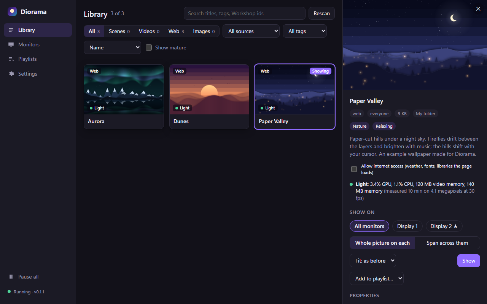

# Diorama

**An open-source live wallpaper engine for Windows that plays the Wallpaper Engine content you already have, plus your own images, videos and web pages.**

Diorama draws animated wallpapers behind your desktop icons: Wallpaper Engine scenes, videos and web wallpapers from your local Steam Workshop folder, Wallpaper Engine's own projects, or files from any folder you add. It is written in Rust on [wgpu](https://wgpu.rs), uses a small [Tauri](https://tauri.app) app for its window, and never needs Steam to be running.

> **Status: early preview (Windows only).** Videos, web wallpapers and images are solid; most scenes look right, some still differ from Wallpaper Engine (see [Compatibility](#compatibility)). Linux and macOS ports are planned.

Diorama is an independent project. It is not affiliated with or endorsed by Wallpaper Engine, its developers, or Valve.


<sub>*Paper Valley*, one of the [example wallpapers](examples/wallpapers) made for Diorama, with a pretend cursor and music.</sub>



## Features

- **Plays Wallpaper Engine content you own**: scenes (layers, effects, particles, 3D models, text, SceneScript, audio-reactive and cursor-reactive layers), videos and web wallpapers, read straight from your local Workshop folder.
- **Your own wallpapers**: images, videos and web pages from any folder. Three [example wallpapers](examples/wallpapers) are included to start from.
- **Per-monitor or spanning**: a different wallpaper per monitor, or one stretched across all of them, with fill / fit / stretch.
- **Wallpaper settings**: each wallpaper's own options (colours, sliders, text, files…), starting from the choices you made in Wallpaper Engine.
- **Playlists**: rotate wallpapers on a timer or by time of day, per monitor.
- **Library**: search by title, tag or Workshop id; filter by type, source and tag; questionable and mature items are hidden until you ask for them; sort by how heavy a wallpaper is.
- **Cost report**: Diorama measures the CPU, GPU and memory each wallpaper really uses and shows it in the library.
- **Light on your PC**:
  - static wallpapers stop drawing entirely;
  - each monitor pauses on its own behind fullscreen apps or maximized windows, while locked or on battery;
  - or stops: the wallpaper is unloaded and its video memory freed while a game runs, and comes back when you leave it;
  - scenes and web wallpapers run at a frame rate cap (30 fps by default), not at your monitor's refresh rate;
  - presets: Balanced, Quality, Gaming, Battery.
- **Robust desktop integration**: works on Windows 11 24H2 with desktop icons hidden, recovers when Explorer restarts or the graphics driver resets, keeps playing when the audio device changes, and follows monitors as they are plugged in or rearranged.
- **Video help**: detects videos your graphics card cannot decode (which would load the CPU) and offers to convert them once.
- **Private by default**: no telemetry, no accounts. Web wallpapers are offline unless you allow a wallpaper to use the internet; updates are checked only when you click "Check for updates". See [PRIVACY.md](PRIVACY.md).
- **Notification-area icon**: open Diorama, next wallpaper, pause / resume, quit.
- **Command line**: everything the app does is also available from `diorama`.

## Install

1. Download `Diorama_<version>_x64-setup.exe` from the [latest release](https://github.com/karmanya007/Diorama/releases/latest).
2. Run it. It installs for your user only (no administrator rights) into `%LOCALAPPDATA%\Diorama`.
   - The installer is not code-signed yet, so Windows SmartScreen may warn: choose **More info → Run anyway**.
3. Open **Diorama** from the Start menu.

**Requirements**

- Windows 10 or 11, 64-bit; tested mostly on Windows 11 24H2.
- A graphics card with Direct3D 12 or Vulkan.
- WebView2: built into Windows 11; the installer fetches it on Windows 10 if it is missing.
- For Wallpaper Engine **scenes**: an installed copy of Wallpaper Engine. Scenes use its built-in shaders and effects, which Diorama reads from your installation and never ships. Videos, web wallpapers and images play without it.

**Updates**: Settings → Updates → **Check for updates**. Updates are signed and installed in place; your settings are kept.

**Uninstall**: Windows Settings → Apps → Diorama. Tick "Delete the application data" to also remove Diorama's settings and caches.

## Using Diorama

- **Library**: lists your Workshop items, Wallpaper Engine's projects and any folders you add (Settings → Library folders). Select a wallpaper to see its details, preview and settings, then choose the monitors and press **Show**.
- **Monitors**: what each monitor shows, and whether it is paused and why.
- **Playlists**: build a list, pick the order and when it changes (every N minutes, or at set times of day), and the monitors it runs on.
- **Settings**: pause rules and presets, volume, library folders, start Diorama when you sign in, updates.

Closing the window leaves your wallpapers running in the background (`dioramad`). Quit from the notification-area icon to stop everything.

### Command line

The installer puts `diorama.exe` next to the app (`%LOCALAPPDATA%\Diorama`):

```sh
diorama set <image | video | scene or web folder> [--fit fill|fit|stretch] [--layout per-output|span]
diorama set <web folder> --allow-network     # let a web wallpaper use the internet
diorama status                               # what plays on each monitor, and why something paused
diorama volume 0-100                         # video soundtrack (0 = muted, the default)
diorama pause | resume | quit
diorama autostart enable | disable | status  # start at sign-in
diorama --help
```

## Compatibility

Measured against the author's own 80 Workshop items and Wallpaper Engine's default projects:

| Content | Status |
|---|---|
| Videos | 21 / 21 play (hardware decoding; unsupported codecs can be converted) |
| Web wallpapers | 4 / 4 work (audio, media and property APIs, PerformanceMonitor widgets) |
| Scenes | 55 / 55 import; compared frame by frame with Wallpaper Engine, 48 / 55 match closely (SSIM ≥ 0.90) and 35 / 55 very closely (≥ 0.95) |

Known gaps:

- planar reflections;
- some camera fades;
- a few shader effects that rely on Direct3D 11 behaviour;
- Wallpaper Engine's application wallpapers and plugins, which are not planned.

If a wallpaper looks wrong, please [open an issue](https://github.com/karmanya007/Diorama/issues) with its Workshop id. A side-by-side screenshot helps a lot.

## How it works

| Process | Role |
|---|---|
| `dioramad` | The wallpaper daemon. One GPU device for all monitors; draws scenes, videos and images into windows placed behind the desktop icons; applies pause rules; runs playlists. |
| `diorama-webhost` | One process per web wallpaper (WebView2), kept separate so a misbehaving page cannot take the rest down. |
| `diorama-ui` | The Diorama window (Tauri). Talks to `dioramad` over a per-user local socket, exactly like the `diorama` CLI. |

Wallpaper Engine content is imported into Diorama's own engine-neutral scene format, so the renderer knows nothing about Wallpaper Engine's files. Workshop content is treated as untrusted input:

- parsers are bounds-checked and fuzzed;
- scripts run in a sandboxed QuickJS with memory and time limits;
- shaders are validated before use;
- web pages are offline by default.

Design decisions are recorded in [docs/adr](docs/adr); file formats in [docs/formats](docs/formats); notes on how Wallpaper Engine content behaves in [docs/re-notes](docs/re-notes).

## Building from source

You need:

- **Rust**: the version is pinned in `rust-toolchain.toml`, and rustup installs it automatically.
- **Visual Studio Build Tools**: the C++ workload.
- **Node.js 22+**: only for the Diorama window and the installer.

```powershell
git clone https://github.com/karmanya007/Diorama
cd Diorama
./scripts/fetch-dxc.ps1                  # pinned DirectX Shader Compiler into .tools/dxc (needed for scenes)
cargo build --release                    # dioramad, diorama, diorama-webhost, diorama-ui, tools
cd apps/diorama-ui; npm install; npm run build; cd ../..
cargo build --release -p diorama-ui        # the window, with the built front end
target/release/diorama-ui                  # starts dioramad on demand
```

During development the daemon also runs on its own:

- `target/release/dioramad --help` lists its options: pause rules, fps, `--scene/--video/--image`, and `--frame-out` to render one frame off-screen.
- Set `DIORAMA_DXC` to `.tools\dxc\dxc.exe` if `dioramad` is not next to a `dxc` folder.
- Settings and logs: `%APPDATA%\Diorama`. Caches: `%LOCALAPPDATA%\Diorama\cache`.

To build the installer, run `./scripts/bundle.ps1`. The result is `target/release/bundle/nsis/`. See [ADR-007](docs/adr/0007-packaging-updates.md) for packaging and releases.

### Repository layout

| Path | Purpose |
|---|---|
| `crates/diorama-core` | Clock, limits, shared foundation types |
| `crates/diorama-scene` | Engine-neutral scene format (layers, materials, effects, particles) |
| `crates/diorama-we` | Wallpaper Engine importer: pkg, tex, mdl, scene/effect/material JSON, shader translation |
| `crates/diorama-gpu` | wgpu device, surfaces, shader compilation and cache |
| `crates/diorama-render` | Scene, video and image rendering |
| `crates/diorama-particles` | Particle simulation |
| `crates/diorama-script` | SceneScript runtime (QuickJS) |
| `crates/diorama-text` | Text layers |
| `crates/diorama-media` | Video decoding (Media Foundation + DXVA) and conversion |
| `crates/diorama-platform` | OS integration: wallpaper windows, monitors, input, power, tray, audio capture |
| `crates/diorama-library` | Finding wallpapers: Workshop, Wallpaper Engine projects, folders |
| `crates/diorama-ipc` | Protocol between `dioramad` and its clients |
| `apps/dioramad` | Wallpaper daemon |
| `apps/diorama-cli` | `diorama` command |
| `apps/diorama-webhost` | Web wallpaper host |
| `apps/diorama-ui` | The Diorama window (Tauri + Svelte) |
| `tools/wpdump` | Inspect and unpack Wallpaper Engine files |
| `tools/imgdiff`, `tools/refcap` | Compare Diorama's frames with reference captures |
| `tests/scenarios` | Manual and scripted checks for desktop behaviour |
| `fuzz` | Fuzz targets for the file parsers |

Tests:

- `cargo test --workspace`.
- Tests that need Wallpaper Engine content read your local installation and skip themselves when it is missing:
  - `DIORAMA_WE_CORPUS` points at the Workshop folder;
  - `DIORAMA_WE_INSTALL` points at the Wallpaper Engine folder.

See [CONTRIBUTING.md](CONTRIBUTING.md) before sending changes.

## Roadmap

- **Windows 1.0**: signed installer, winget, remaining scene differences.
- **Linux**:
  - Wayland (wlr-layer-shell compositors, KDE, GNOME) and X11;
  - VA-API video, PipeWire audio;
  - Flatpak and distribution packages.
- **macOS.**
- **An editor** for Diorama's own wallpaper format.

## Content and legal

Diorama does not include or redistribute Wallpaper Engine's program, assets, shaders, or any Workshop content. It reads them from your own installation and subscriptions at run time, for interoperability with files you already have. Please do not commit or attach extracted Wallpaper Engine or Workshop content to issues or pull requests.

"Wallpaper Engine" and "Steam" are trademarks of their respective owners and are used here only to describe compatibility.

## License

Diorama is dual-licensed under [MIT](LICENSE-MIT) or [Apache-2.0](LICENSE-APACHE), at your option. The installer also ships the DirectX Shader Compiler (`dxc.exe`, `dxcompiler.dll`) under its own LLVM and MIT licences, included beside it.
