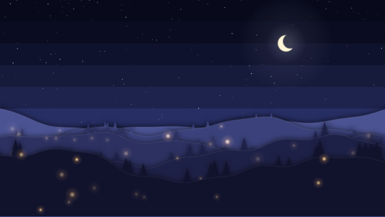
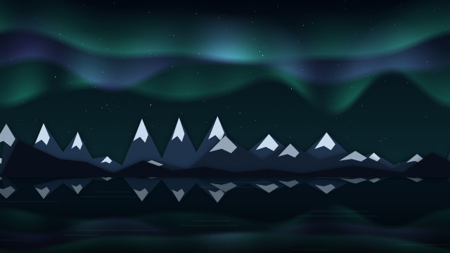
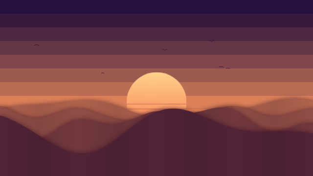

# Example wallpapers

Three web wallpapers made for Diorama. Use them, change them, or start your own from them. They are covered by the project's licence (MIT or Apache-2.0).

| | |
|---|---|
|  | **Paper Valley**: paper-cut hills under a night sky. Fireflies drift between the layers and brighten with music; the hills shift with your cursor. |
|  | **Aurora**: northern lights ripple over snowy peaks and a still lake, and swell with music. |
|  | **Dunes**: a banded sunset over paper-cut dunes. Birds cross the sky, and the sun pulses gently with music. |

## Using them

In Diorama, open Settings → Library folders and add this `examples/wallpapers` folder (or a copy of it). The three wallpapers then appear in the library. Each one has settings (colours, counts, speed) in its details panel.

## How they are made

Each is a single `index.html` with a `<canvas>` and no dependencies. It uses the standard web wallpaper interface that Diorama shares with Wallpaper Engine:

- `window.wallpaperPropertyListener.applyUserProperties` receives the settings declared in `project.json`;
- `window.wallpaperRegisterAudioListener` receives 128 audio levels (64 per channel) about 30 times a second;
- mouse events give the cursor position.

Options in the address, useful for previews and recordings:

- `?t=<seconds>` draws one still frame at that time;
- `&loop=<seconds>` makes every motion repeat after that many seconds;
- `&demo` (Paper Valley only) moves a pretend cursor and plays pretend music.

For example, `index.html?t=3&loop=8&demo` is the frame used for Paper Valley's preview.
